<!-- ═══════════════════════════ HEADER ═══════════════════════════ -->
<p align="center">
  
</p>

<p align="center">
  <a href="https://github.com/reburak0">
    
  </a>
</p>

<p align="center">
  
  
  
</p>


##  About Me

<table>
<tr>
<td width="58%">

```ts
const burak = {
  role:      "Full Stack Developer",
  frontend:  ["React", "TypeScript", "JavaScript", "HTML5", "CSS3"],
  backend:   ["Node.js", "Laravel", "PHP", "Python", "C#"],
  mobile:    ["Kotlin"],
  focus:     ["Clean architecture", "REST APIs", "Modern UI/UX"],
  motto:     "Ship it, then make it beautiful ✨",
};
```

- 🔭 Currently building **full stack web apps** end to end
- 🌱 Always learning new tools & best practices
- 💬 Ask me about **React, Laravel, Node.js & APIs**
- ⚡ Fun fact: I debug better after midnight 🌙

</td>
<td width="42%" align="center">
  
</td>
</tr>
</table>


## 🛠️ Tech Stack

<h3 align="center">Languages & Frameworks</h3>
<p align="center">
  <a href="https://skillicons.dev">
    
  </a>
</p>

<h3 align="center">Tools & Platforms</h3>
<p align="center">
  <a href="https://skillicons.dev">
    
  </a>
</p>

<p align="center">
  
  
  
  
  
  
  
  
  
  
  
</p>


## 📊 GitHub Stats

<p align="center">
  
  
</p>

<p align="center">
  
</p>

<p align="center">
  
</p>


## 🐍 Contribution Snake

<p align="center">
  <picture>
    <source media="(prefers-color-scheme: dark)" srcset="https://raw.githubusercontent.com/reburak0/reburak0/output/github-snake-dark.svg" />
    <source media="(prefers-color-scheme: light)" srcset="https://raw.githubusercontent.com/reburak0/reburak0/output/github-snake.svg" />
    
  </picture>
</p>

## 🤝 Connect With Me

<p align="center">
  <a href="https://github.com/reburak0"></a>
  <a href="https://www.linkedin.com/in/YOUR_LINKEDIN"></a>
  <a href="mailto:YOUR_EMAIL"></a>
  <a href="https://instagram.com/YOUR_INSTAGRAM"></a>
</p>

<p align="center">
  
</p>
